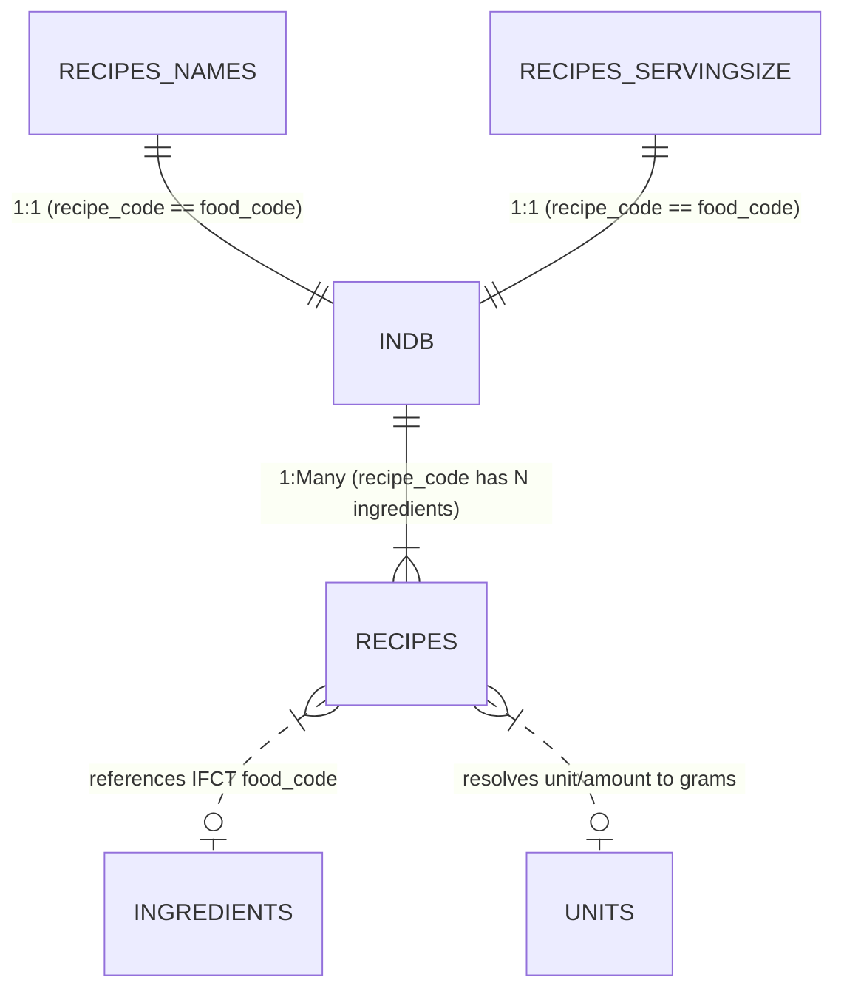

# Comprehensive Data Profiling Report: Indian Nutrient Databank (INDB) & Recipe Datasets

**Author:** Antigravity Senior Engineering & Nutrition Data Architecture Team  
**Date:** October 25, 2026  
**Repository:** FitMe 2.0  
**Phase:** Phase 1 — Dataset Inspection & Data Profiling  

---

## 1. Executive Summary

This profiling report documents the structural, nutritional, and relational characteristics of the 5 uploaded source Excel spreadsheets:
1. `INDB.xlsx` (1,014 records, 82 columns)
2. `recipes.xlsx` (10,271 records, 13 columns)
3. `recipes_names.xlsx` (1,014 records, 5 columns)
4. `recipes_servingsize.xlsx` (1,014 records, 13 columns)
5. `Units.xlsx` (345 records, 5 columns)

All 5 datasets have been inspected using Pandas and OpenPyXL without modifying or overwriting source files.

---

## 2. Spreadsheet-by-Spreadsheet Profiling

### A. `INDB.xlsx` (Indian Nutrient Databank - Prepared Dishes)
- **Worksheet Name:** `Nutrient Data`
- **Dimensions:** 1,014 rows × 82 columns
- **Primary Identifier:** `food_code` (e.g., `ASC001` to `ASC490`, `BFP001` to `BFP376`, `OSR001` to `OSR148`)
- **Key Findings:**
  - **Uniqueness:** 1,014 distinct `food_code`s; **0 duplicates**.
  - **Names:** 1,014 distinct `food_name`s; **0 duplicates**.
  - **Completeness:** 0 missing values in core macronutrients (`energy_kcal`, `carb_g`, `protein_g`, `fat_g`).
  - **Dual Nutrition Basis:**
    - Columns 4 to 42: Expressed **per 100 grams** (e.g., `energy_kcal` mean: 233.74 kcal, min: 6.61, max: 839.33 kcal).
    - Columns 44 to 82: Expressed **per serving unit** (`unit_serving_energy_kcal`, `unit_serving_carb_g`, `unit_serving_protein_g`, `unit_serving_fat_g`).
  - **Serving Units:** 917 recipes have defined serving units (`bowl`: 269, `plate`: 72, `piece`: 57, `biscuit`: 29, `tall glass`: 21, `cup`: 19, `slice`: 19, `soup bowl`: 18); 97 recipes have null `servings_unit`.
  - **Implied Serving Weights:** Derived via `(unit_serving_energy_kcal / energy_kcal) * 100`.
    - Mean: 235.26g, Median: 191.28g, IQR: 85.53g – 320.31g.
  - **Provenance:** `primarysource` attribute breakdown:
    - `asc_manual`: 490 recipes (48.3%)
    - `bfp_manual`: 376 recipes (37.1%)
    - `open_source_recipes`: 148 recipes (14.6%)

---

### B. `recipes_names.xlsx` (Master Recipe Registry)
- **Worksheet Name:** `sheet1`
- **Dimensions:** 1,014 rows × 5 columns
- **Columns:** `['recipe_code_org', 'recipe_code', 'recipe_name_org', 'recipe_name', 'primarysource']`
- **Key Findings:**
  - `recipe_code` maps **exactly 1:1** to `INDB.xlsx` `food_code` across all 1,014 dishes.
  - Contains standardized bilingual dish names (e.g., `Hot tea (Garam Chai)` with original shorthand `Hot Tea`).

---

### C. `recipes_servingsize.xlsx` (Serving Size Definitions)
- **Worksheet Name:** `Sheet1`
- **Dimensions:** 1,014 rows × 13 columns
- **Columns:** `['recipe_code_org', 'recipe_code', 'recipe_name_org', 'recipe_name', 'primarysource', 'no_of_servings_org', 'no_of_servings', 'size_of_servings_org', 'size_of_servings', 'servings_unit_org', 'servings_unit', 'remarks_1', 'remarks_2']`
- **Key Findings:**
  - `recipe_code` matches `INDB.xlsx` `food_code` 100% (1,014 / 1,014).
  - `no_of_servings`: Cooked batch yield count (e.g. 2, 4, 6 servings per prepared recipe). Null in 82 rows.
  - `size_of_servings`: Portion multiplier (typically 1.0). Null in 82 rows.
  - `servings_unit`: Exact match with `INDB.xlsx` in 917 recipes; 97 records lack serving unit specification.

---

### D. `recipes.xlsx` (Recipe Ingredient Breakdown)
- **Worksheet Name:** `Sheet1`
- **Dimensions:** 10,271 rows × 13 columns
- **Columns:** `['recipe_code_org', 'recipe_code', 'recipe_name_org', 'recipe_name', 'ingredient_name_org', 'amount_org', 'unit_org', 'food_code_org', 'food_name_org', 'food_code', 'food_name', 'amount', 'unit']`
- **Key Findings:**
  - All 1,014 recipes from `INDB.xlsx` have ingredient breakdowns in this file.
  - An average of ~10.1 ingredients per recipe (min 1, max 38).
  - **Ingredient Identifiers:** References 332 distinct ingredient `food_code` values (IFCT / Indian Food Composition Tables codes, e.g. `L002` Cow's milk, `I502` Sugar, `A003` Rice, `D500` Dal).
  - **Missing Identifiers:** 123 rows have missing `food_code` (e.g., saffron, garnishing sprigs, ice cubes, salt/water to taste).
  - **Quantities & Units:**
    - `g` (grams): 4,759 rows (46.3%)
    - `tsp` (teaspoons): 3,660 rows (35.6%)
    - `tbsp` (tablespoons): 844 rows (8.2%)
    - `ml` (milliliters): 473 rows (4.6%)
    - `C` (cups): 275 rows (2.7%)
    - `sprig`: 247 rows (2.4%)
    - `nos` / `pinch` / `sheet` / `drops`: 13 rows (<0.2%)
    - Missing `amount` / `unit`: 3 rows.

---

### E. `Units.xlsx` (Household Measure Conversions)
- **Worksheet Name:** `Sheet1`
- **Dimensions:** 345 rows × 5 columns
- **Columns:** `['Food items', 'Units', 'Units.1', 'Remarks', 'Source']`
- **Key Findings:**
  - Non-empty entries: 327 rows.
  - Maps common Indian and international culinary units:
    - `1 cup` = `240ml` / `240g` (water/general)
    - `1 tsp` = `5ml` / `5g`
    - `1 tbsp` = `15ml` / `15g`
    - Specific ingredient density mappings (e.g. butter 1 knob = 20g, oil 1 tbsp = 14.2g, mayonnaise 1 tbsp = 13.8g, source: USDA FDC).
  - Contains descriptive preparation instructions (e.g. `tempering` = 2 tbsp oil, `frying` = 2 cups oil) which must be treated as explicit recipe assumptions rather than universal weights.

---

## 3. Relational Architecture & Key Mappings

1. **`recipes` table (Composite Prepared Dishes):**
   - Source: `INDB.xlsx` joined with `recipes_names.xlsx` and `recipes_servingsize.xlsx`.
   - Key: `source_recipe_code` (`ASC001`, `BFP001`, etc.).
   - Contains: Official verified nutrition per 100g, official nutrition per serving, and portion size.

2. **`recipe_ingredients` table (Bill of Materials):**
   - Source: `recipes.xlsx`.
   - Links each recipe to ingredient name, source ingredient code, amount, and unit.

3. **`ingredients` table (Raw/Base Food Components):**
   - Derived from the 332 distinct ingredient codes and food names referenced in `recipes.xlsx`.
   - Standardized per 100g.

---

## 4. Discrepancies, Ambiguities & Data Limitations Report

| Issue ID | Affected Dataset | Description | Proposed Engineering Resolution |
|---|---|---|---|
| **DISC-01** | `INDB.xlsx` | 97 recipes have null `servings_unit`. | Keep `servings_unit` nullable; fallback to 100g standard portion or ask user for portion clarification. |
| **DISC-02** | `recipes.xlsx` | 123 ingredient rows have missing `food_code` (e.g., garnishing sprigs, saffron, water). | Flag with `conversion_status = 'unmapped_minor_ingredient'` and zero calorie impact for water/garnishes. |
| **DISC-03** | `recipes.xlsx` | 3 rows have null `amount` or null `unit`. | Quarantine and flag in quality report; assign default assumption or mark `conversion_status = 'missing_quantity'`. |
| **DISC-04** | `recipes_servingsize.xlsx` | 82 rows have null `no_of_servings` or `size_of_servings`. | Retain `NULL`; default serving multiplier to 1.0 when missing. |
| **DISC-05** | `Units.xlsx` | Unstructured columns (`Units`, `Units.1`) with mixed text and density citations. | Parse into a structured lookup table (`source_unit`, `target_unit`, `gram_multiplier`, `food_context`). |

---

## 5. Licensing & Data Provenance Notice

- The Indian Nutrient Databank (INDB) data originates from published Indian food composition databases (ICMR-NIN IFCT, ASC Manual, BFP Manual).
- Normalized CSV exports retain exact source codes, provenance tags, and revision timestamps to ensure full scientific traceability.
- Original Excel spreadsheets remain immutable in the repository.
